# 造物案例馆

真实制作、分类清楚、可追溯的 AI 图像与代码创作案例。网站负责展示，仓库保存产物与过程。

## 运行

无需安装第三方运行依赖。Three.js 实例随包提供 MIT 许可运行库，其余作品按各自说明运行。构建需要 Node 20+ 和 Python 3；`npm test` 与 `npm run build` 会先用 Python 3 恢复并校验大文件。以静态服务器服务 `dist/`；请勿直接用 file:// 打开首页。

## 在线作品集

[打开造物案例馆](https://cloudenshine.github.io/original-ai-gallery/) · 29 件作品。部署是否完成以 GitHub Actions 的 Pages 结果为准。

## 把黄昏折成一座山

纸的纤维、玻璃的折光、石的沉静。用三种材料，搭出一座只存在于想象里的微缩山河。

- 用途：概念视觉
- 制作方式：image-generation
- 工具：ChatGPT 内置图像生成
- 模型：ChatGPT 图像生成，具体模型版本未披露
- [真实产物](https://cloudenshine.github.io/original-ai-gallery/cases/folded-dusk/original.png) · [源码或提示词](https://cloudenshine.github.io/original-ai-gallery/cases/folded-dusk/prompt.txt) · [来源与验证](dist/cases/folded-dusk/provenance.json)
- 验证：已实际生成并目视检查；1536 × 1024 PNG，SHA-256 已核。累计生成 2 次，本页为当前新输出。具体模型版本未披露，不是真实摄影。

## 无名地形

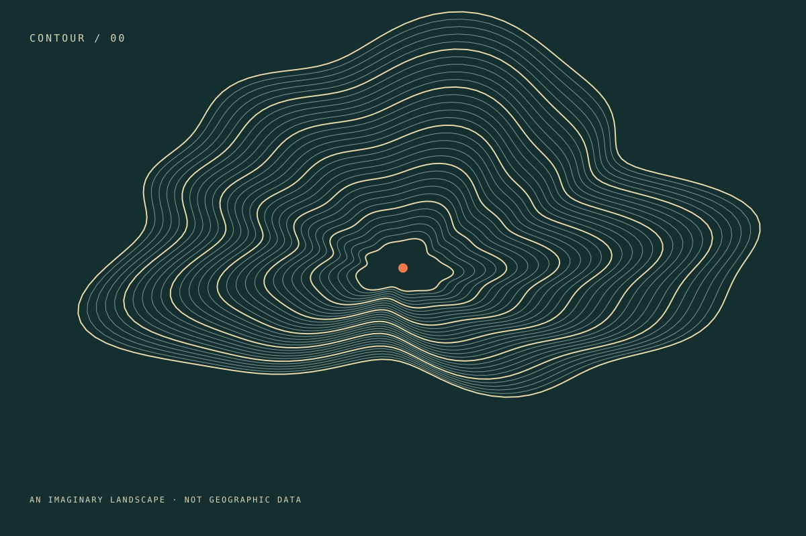

没有一张地图被借用。31 条闭合曲线从同一组规则生长，每个种子都是一座没有名字的岛。

- 用途：生成艺术
- 制作方式：procedural-image
- 工具：SVG + JavaScript
- 模型：ChatGPT 协作，具体底层模型未披露
- [真实产物](https://cloudenshine.github.io/original-ai-gallery/cases/contour-atlas/index.html) · [源码或提示词](https://cloudenshine.github.io/original-ai-gallery/cases/contour-atlas/demo-source.zip) · [来源与验证](dist/cases/contour-atlas/provenance.json)
- 验证：已导出 18 秒 1200×900/30fps 带声种子切换导览；00、01、02 为原 SVG 离散状态，闭合性、确定性、有限值及全文件解码通过。非连续地形动画、非实测地图、非浏览器录屏；完整实时看听与浏览器播放未验。

## 相位花园

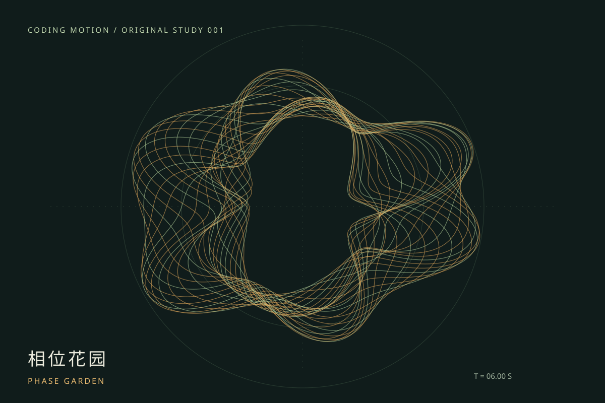

让时间成为画笔。两组细线轨道在相位差里交织，暂停、拖动，再找到你喜欢的那个瞬间。

- 用途：界面动效
- 制作方式：coding-motion
- 工具：Canvas + JavaScript
- 模型：ChatGPT 协作，具体底层模型未披露
- [真实产物](https://cloudenshine.github.io/original-ai-gallery/cases/phase-garden/index.html) · [源码或提示词](https://cloudenshine.github.io/original-ai-gallery/cases/phase-garden/demo-source.zip) · [来源与验证](dist/cases/phase-garden/provenance.json)
- 验证：原有播放、暂停、重播、时间与幅度核心测试通过。新增 30 秒有声演示：1280×800、30 fps，原作算法离线导出，幅度 0.80；原创配乐与节点音效。全片解码、抽帧和源包哈希已核；浏览器连续观看与主观听审未完成。

## 回到平衡

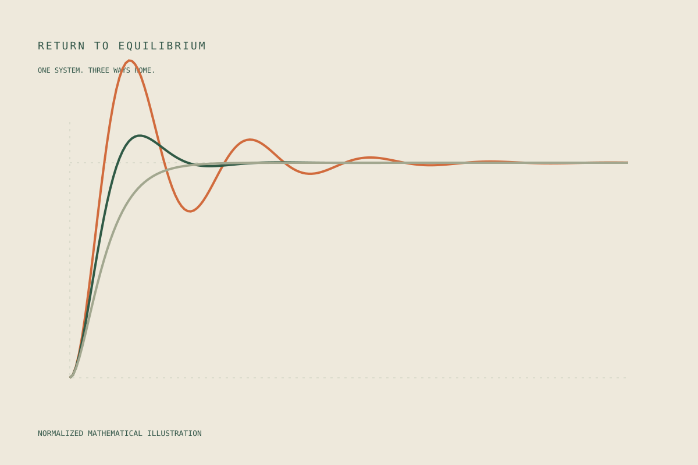

为什么有些动效轻轻到达，有些却来回摆动？拖一条滑杆，看阻尼如何改变回到平衡的过程。

- 用途：知识解释
- 制作方式：interactive
- 工具：JavaScript + SVG
- 模型：ChatGPT 协作，具体底层模型未披露
- [真实产物](https://cloudenshine.github.io/original-ai-gallery/cases/spring-lab/index.html) · [源码或提示词](https://cloudenshine.github.io/original-ai-gallery/cases/spring-lab/demo-source.zip) · [来源与验证](dist/cases/spring-lab/provenance.json)
- 验证：已导出 24 秒 1280×720/30fps 带声 MP4，四种阻尼响应；归一化模型与独立数值积分对照通过、全文件解码和编码画面抽检通过。非实测或工程性能数据；未完成真人连续看听与实际浏览器验收。

## 夜航路线

把城市想象成一张会呼吸的路线图。调节班次密度，观察光点如何沿三条路线穿越、停靠，再各自远去。原创虚构网络，不含实际地图或客流数据。

- 用途：信息可视化
- 制作方式：coding-motion
- 工具：Canvas 2D + JavaScript
- 模型：ChatGPT 协作，具体底层模型未披露
- [真实产物](https://cloudenshine.github.io/original-ai-gallery/cases/night-transit/index.html) · [源码或提示词](https://cloudenshine.github.io/original-ai-gallery/cases/night-transit/scene.mjs) · [来源与验证](dist/cases/night-transit/provenance.json)
- 验证：原生 Canvas 实帧、全周期取样及静音 MP4 技术预览已导出；模型与共享控件事件测试通过。浏览器与手机实际验收暂未完成。

## 轨道观测台

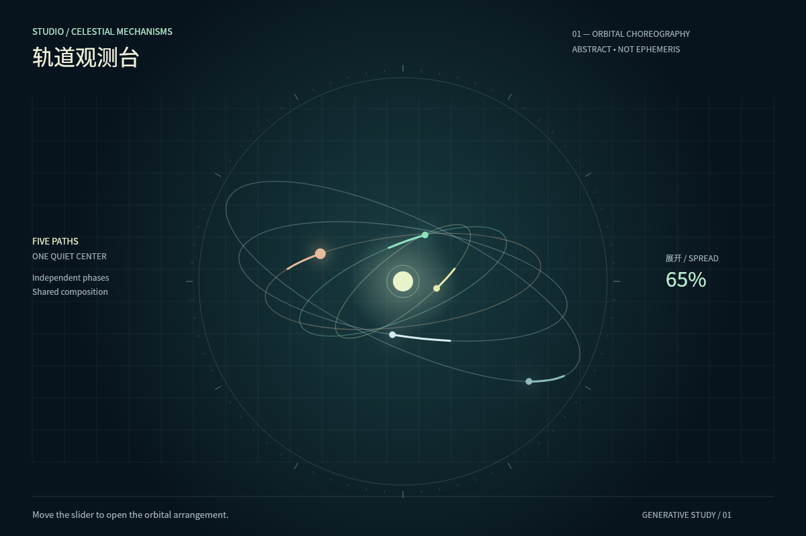

五条倾斜轨道围绕一枚光核缓慢交错，轨道展开度直接改变空间构型。

- 用途：科学主题视觉、音乐舞台背景、交互展陈
- 制作方式：coding-motion
- 工具：Canvas 2D + JavaScript
- 模型：ChatGPT 协作，具体底层模型未披露
- [真实产物](https://cloudenshine.github.io/original-ai-gallery/cases/orbit-observatory/index.html) · [源码或提示词](https://cloudenshine.github.io/original-ai-gallery/cases/orbit-observatory/scene.mjs) · [来源与验证](dist/cases/orbit-observatory/provenance.json)
- 验证：原生 Canvas 实帧、全周期取样及静音 MP4 技术预览已导出；模型与共享控件事件测试通过。浏览器与手机实际验收暂未完成。 新增有声演示已全文件解码，原无声版本及交互保留；完整实时看听和浏览器播放未验。

## 两色之间

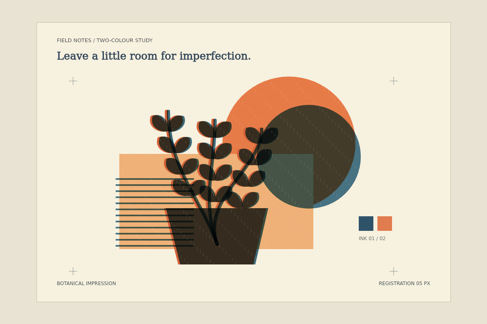

一张想象中的植物印样，由暖橙和靛蓝两块色版逐次叠印。调节套准偏移，观察边缘错位与色块重叠；这是程序图形示意，不是印刷设备模拟。

- 用途：视觉设计实验
- 制作方式：interactive
- 工具：Canvas 2D + JavaScript
- 模型：ChatGPT 协作，具体底层模型未披露
- [真实产物](https://cloudenshine.github.io/original-ai-gallery/cases/overprint-studio/index.html) · [源码或提示词](https://cloudenshine.github.io/original-ai-gallery/cases/overprint-studio/scene.mjs) · [来源与验证](dist/cases/overprint-studio/provenance.json)
- 验证：原生 Canvas 实帧、全周期取样及静音 MP4 技术预览已导出；模型与共享控件事件测试通过。浏览器与手机实际验收暂未完成。 新增有声演示与源码包已恢复并重新核验：全文件解码、源包成员哈希和重建一致性通过；原无声版本及交互保留。完整实时看听和浏览器播放未验。

## 纸城入夜

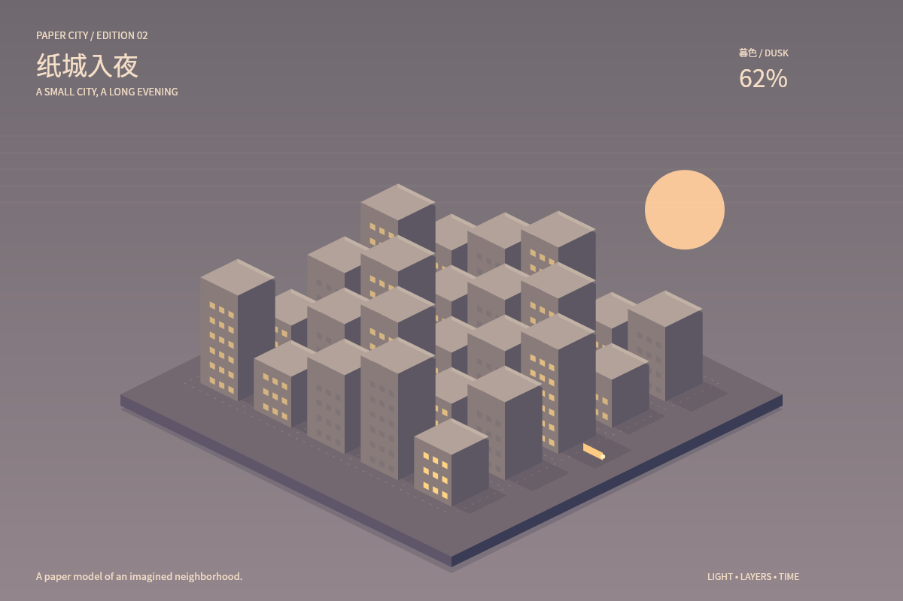

二十五栋折纸建筑组成暮光街区，调节夜色可改变窗光，太阳与电车缓慢移动。

- 用途：城市主题片头、品牌叙事、建筑互动插画
- 制作方式：coding-motion
- 工具：Canvas 2D + JavaScript
- 模型：ChatGPT 协作，具体底层模型未披露
- [真实产物](https://cloudenshine.github.io/original-ai-gallery/cases/paper-city/index.html) · [源码或提示词](https://cloudenshine.github.io/original-ai-gallery/cases/paper-city/scene.mjs) · [来源与验证](dist/cases/paper-city/provenance.json)
- 验证：原生 Canvas 实帧、全周期取样及静音 MP4 技术预览已导出；模型与共享控件事件测试通过。浏览器与手机实际验收暂未完成。 新增有声演示与源码包已恢复并重新核验：全文件解码、源包成员哈希和重建一致性通过；原无声版本及交互保留。完整实时看听和浏览器播放未验。

## 一束光的岔路

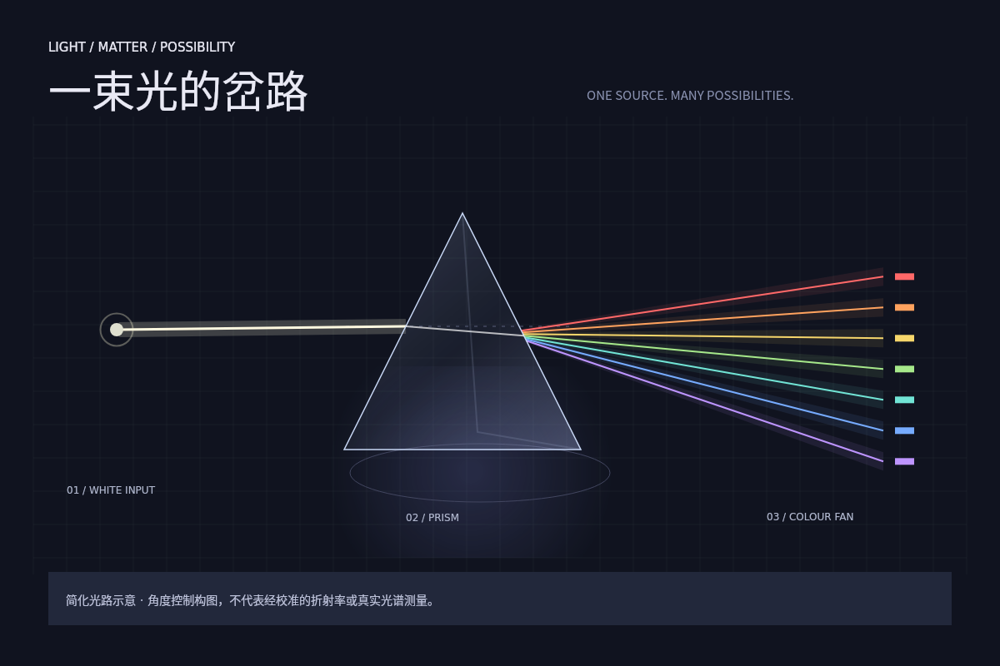

在深色光学工作台上改变入射方向，观察白光展开为有序色带。简化示意，非物理校准。

- 用途：概念教学 · 交互展陈 · 科学视觉
- 制作方式：interactive
- 工具：Canvas 2D + JavaScript
- 模型：ChatGPT 协作，具体底层模型未披露
- [真实产物](https://cloudenshine.github.io/original-ai-gallery/cases/prism-desk/index.html) · [源码或提示词](https://cloudenshine.github.io/original-ai-gallery/cases/prism-desk/scene.mjs) · [来源与验证](dist/cases/prism-desk/provenance.json)
- 验证：原生 Canvas 实帧、全周期取样及静音 MP4 技术预览已导出；模型与共享控件事件测试通过。浏览器与手机实际验收暂未完成。 新增有声演示与源码包已恢复并重新核验：全文件解码、源包成员哈希和重建一致性通过；原无声版本及交互保留。完整实时看听和浏览器播放未验。

## 檐下听雨

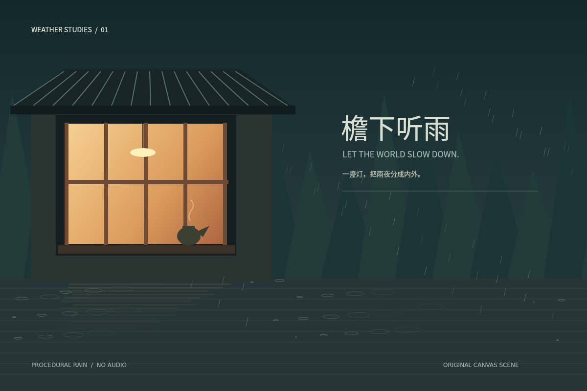

雨线在檐外落下，涟漪沿石阶展开。一幅以代码绘制的雨夜小景。

- 用途：氛围场景 · 品牌开场 · 循环背景
- 制作方式：coding-motion
- 工具：Canvas 2D + JavaScript
- 模型：ChatGPT 协作，具体底层模型未披露
- [真实产物](https://cloudenshine.github.io/original-ai-gallery/cases/rain-study/index.html) · [源码或提示词](https://cloudenshine.github.io/original-ai-gallery/cases/rain-study/scene.mjs) · [来源与验证](dist/cases/rain-study/provenance.json)
- 验证：原生 Canvas 实帧、全周期取样及静音 MP4 技术预览已导出；模型与共享控件事件测试通过。浏览器与手机实际验收暂未完成。 新增有声演示与源码包已恢复并重新核验：全文件解码、源包成员哈希和重建一致性通过；原无声版本及交互保留。完整实时看听和浏览器播放未验。

## 信号成字

散落的字母沿各自轨迹归位，停留成一张有呼吸的活版海报。

- 用途：动态字体 · 片头设计 · 品牌宣言
- 制作方式：coding-motion
- 工具：Canvas 2D + JavaScript
- 模型：ChatGPT 协作，具体底层模型未披露
- [真实产物](https://cloudenshine.github.io/original-ai-gallery/cases/signal-letterpress/index.html) · [源码或提示词](https://cloudenshine.github.io/original-ai-gallery/cases/signal-letterpress/scene.mjs) · [来源与验证](dist/cases/signal-letterpress/provenance.json)
- 验证：原生 Canvas 实帧、全周期取样及静音 MP4 技术预览已导出；模型与共享控件事件测试通过。浏览器与手机实际验收暂未完成。 新增有声演示与源码包已恢复并重新核验：全文件解码、源包成员哈希和重建一致性通过；原无声版本及交互保留。完整实时看听和浏览器播放未验。

## 潮汐织场

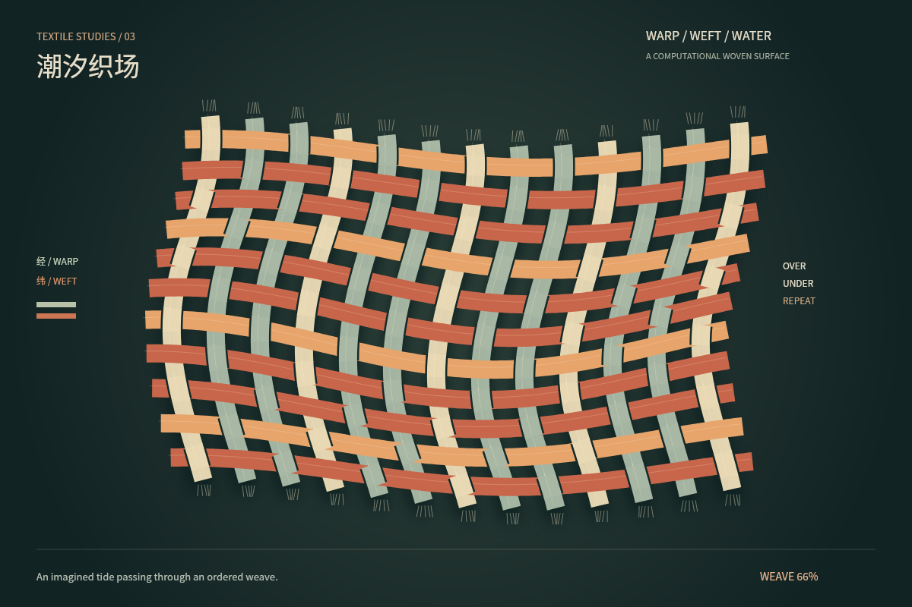

经纬丝带沿共同的波面起伏，交叉处严格交替穿插，织幅参数控制波动强度。

- 用途：纺织品牌视觉、抽象艺术海报、参数化设计展示
- 制作方式：coding-motion
- 工具：Canvas 2D + JavaScript
- 模型：ChatGPT 协作，具体底层模型未披露
- [真实产物](https://cloudenshine.github.io/original-ai-gallery/cases/tidal-weave/index.html) · [源码或提示词](https://cloudenshine.github.io/original-ai-gallery/cases/tidal-weave/scene.mjs) · [来源与验证](dist/cases/tidal-weave/provenance.json)
- 验证：原生 Canvas 实帧、全周期取样及静音 MP4 技术预览已导出；模型与共享控件事件测试通过。浏览器与手机实际验收暂未完成。 新增有声演示与源码包已恢复并重新核验：全文件解码、源包成员哈希和重建一致性通过；原无声版本及交互保留。完整实时看听和浏览器播放未验。

## 琥珀与石灰岩

用克制的三物体构图呈现石灰岩、玻璃与薄纸的材质差异。

- 用途：产品静物
- 制作方式：image-generation
- 工具：ChatGPT 内置图像生成
- 模型：ChatGPT 图像生成，具体模型版本未披露
- [真实产物](https://cloudenshine.github.io/original-ai-gallery/cases/image-amber-limestone/original.png) · [源码或提示词](https://cloudenshine.github.io/original-ai-gallery/cases/image-amber-limestone/prompt.txt) · [来源与验证](dist/cases/image-amber-limestone/provenance.json)
- 验证：目视通过。主体接触阴影自然，琥珀玻璃高光、石材微孔及薄纸透光清晰；无品牌、人物或乱码。 1536 × 1024 PNG，SHA-256 已复核。虚构产品的生成式视觉，不代表可制造性验证。

## 潮汐阅览室

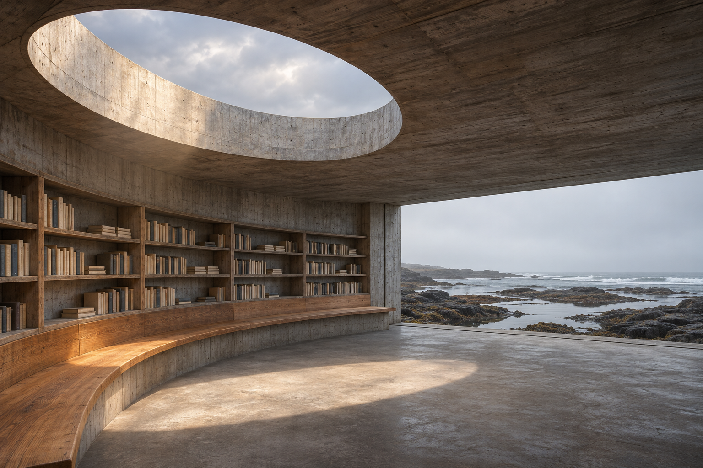

以椭圆天窗、混凝土曲面与海岸开口组织安静的阅读空间。

- 用途：建筑概念
- 制作方式：image-generation
- 工具：ChatGPT 内置图像生成
- 模型：ChatGPT 图像生成，具体模型版本未披露
- [真实产物](https://cloudenshine.github.io/original-ai-gallery/cases/image-tidal-reading-room/original.png) · [源码或提示词](https://cloudenshine.github.io/original-ai-gallery/cases/image-tidal-reading-room/prompt.txt) · [来源与验证](dist/cases/image-tidal-reading-room/provenance.json)
- 验证：目视通过。天窗与曲面长凳形成连贯空间，海岸层次清晰，无人物、标志或可读书名。 1536 × 1024 PNG，SHA-256 已复核。虚构建筑概念图，未进行结构、海岸防护或建筑规范审核。

## 种子渡夜

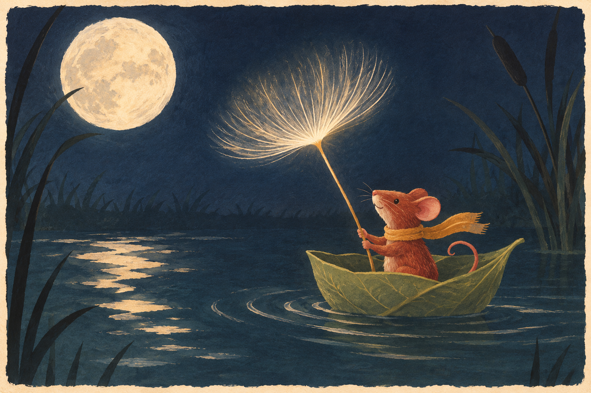

小田鼠用叶舟运送一枚发光的蒲公英种子，纸本水粉质感与月光共同构成叙事。

- 用途：叙事插画
- 制作方式：image-generation
- 工具：ChatGPT 内置图像生成
- 模型：ChatGPT 图像生成，具体模型版本未披露
- [真实产物](https://cloudenshine.github.io/original-ai-gallery/cases/image-seed-courier/original.png) · [源码或提示词](https://cloudenshine.github.io/original-ai-gallery/cases/image-seed-courier/prompt.txt) · [来源与验证](dist/cases/image-seed-courier/provenance.json)
- 验证：目视通过。角色轮廓与手持关系清晰，单只鼠、单条尾巴、单叶舟成立；纸张肌理与深靛色层次稳定。 1536 × 1024 PNG，SHA-256 已复核。童话性比例与发光种子属于艺术设定，不作植物学或动物学图解。

## 种子温室

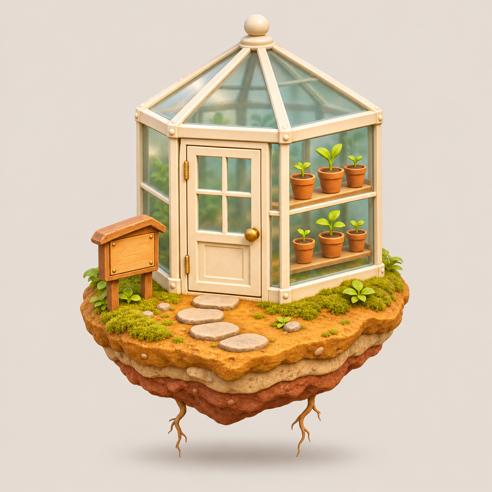

以象牙色温室、盆栽与悬浮土壤剖面构成可爱但克制的微缩场景。

- 用途：3D 风格微缩场景
- 制作方式：image-generation
- 工具：ChatGPT 内置图像生成
- 模型：ChatGPT 图像生成，具体模型版本未披露
- [真实产物](https://cloudenshine.github.io/original-ai-gallery/cases/image-seed-library/original.png) · [源码或提示词](https://cloudenshine.github.io/original-ai-gallery/cases/image-seed-library/prompt.txt) · [来源与验证](dist/cases/image-seed-library/provenance.json)
- 验证：成品目视通过。透明版本彩边未通过审核，最终改为不透明浅灰背景；成品轮廓干净、全物体未裁切，六盆植物与层状土壤可读。 1254 × 1254 PNG，SHA-256 已复核。这是 3D 风格的二维生成图，不含真实网格、材质节点或 3D 工程文件。最终图不是透明素材。垂直留白较提示词目标紧，但无裁切。

## 雨水花园剖面

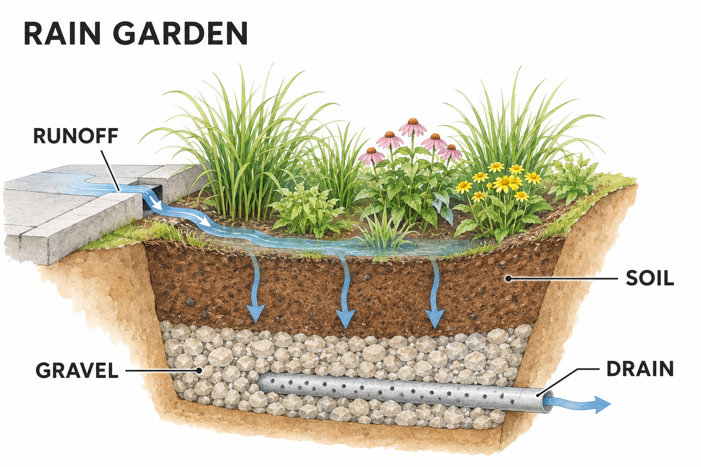

用水彩式剖面展示地表径流、种植土、碎石层和排水管的关系。

- 用途：概念性教育图解
- 制作方式：image-generation
- 工具：ChatGPT 内置图像生成
- 模型：ChatGPT 图像生成，具体模型版本未披露
- [真实产物](https://cloudenshine.github.io/original-ai-gallery/cases/image-rain-garden/original.png) · [源码或提示词](https://cloudenshine.github.io/original-ai-gallery/cases/image-rain-garden/prompt.txt) · [来源与验证](dist/cases/image-rain-garden/provenance.json)
- 验证：目视通过。RAIN GARDEN、RUNOFF、SOIL、GRAVEL、DRAIN 五处文字均正确；土层在碎石上方，排水管位于碎石层，水流箭头方向一致。 1536 × 1024 PNG，SHA-256 已复核。只示意一种带排水管的雨水花园配置，不是施工图、设计规范或经过专家校审的科学教材。

## 把冬天拆小

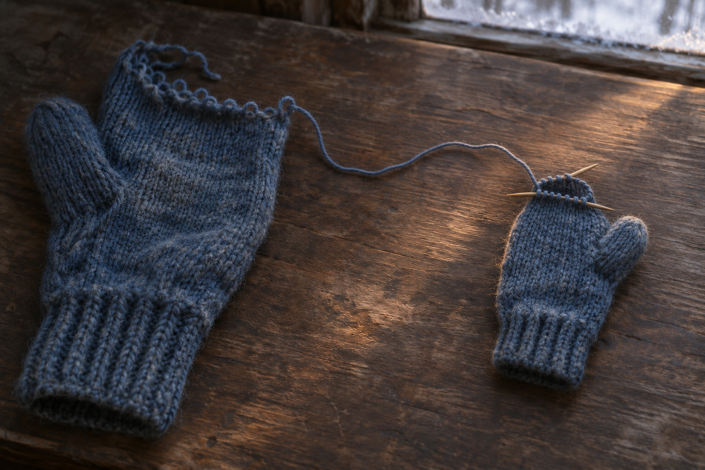

一根毛线从成人尺寸旧手套连到小手套，保留初稿与局部修订。

- 用途：概念视觉
- 制作方式：image-editing
- 工具：ChatGPT 图像生成与编辑
- 模型：Exact image model not disclosed
- [真实产物](https://cloudenshine.github.io/original-ai-gallery/cases/making-winter-smaller/index.html) · [源码或提示词](https://cloudenshine.github.io/original-ai-gallery/cases/making-winter-smaller/source.zip) · [来源与验证](dist/cases/making-winter-smaller/provenance.json)
- 验证：已核对媒体文件 SHA-256；虚构静物，不是针织教学或真实事件照片。

## 月相的负形

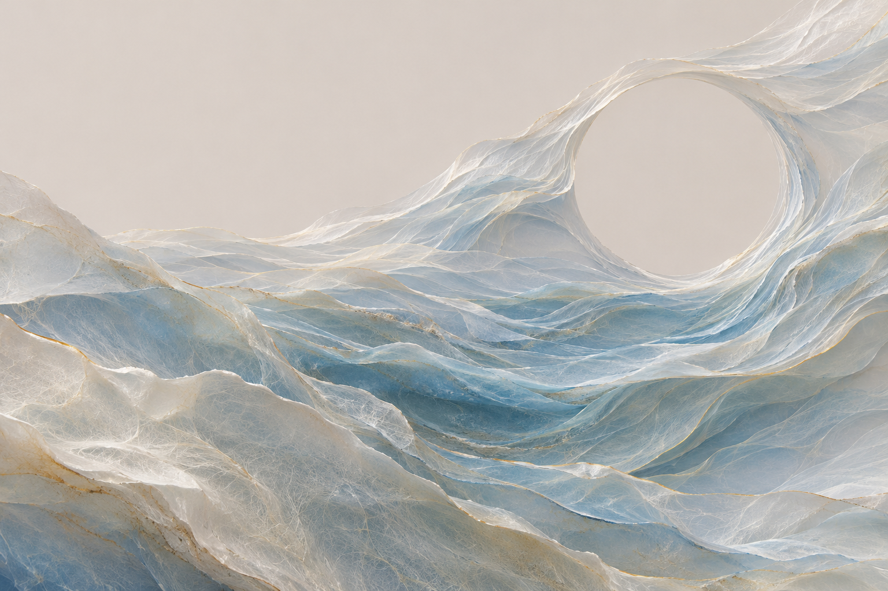

层叠的半透明薄片和潮线围绕留白，暗示一轮没有画出的月亮。

- 用途：概念视觉
- 制作方式：image-generation
- 工具：ChatGPT 图像生成与编辑
- 模型：Exact image model not disclosed
- [真实产物](https://cloudenshine.github.io/original-ai-gallery/cases/negative-of-a-moon/index.html) · [源码或提示词](https://cloudenshine.github.io/original-ai-gallery/cases/negative-of-a-moon/source.zip) · [来源与验证](dist/cases/negative-of-a-moon/provenance.json)
- 验证：已核对媒体文件 SHA-256；单帧 PNG，不证明原生 GIF、SVG 或特定模型能力。 提示词可复用，生成图像不承诺逐像素复现。

## 借一弯月光

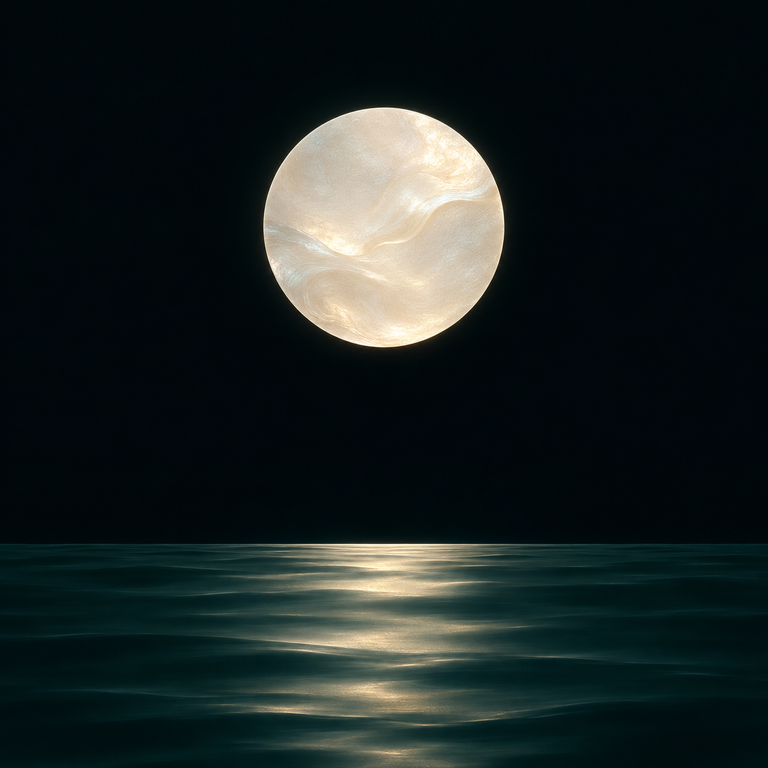

月轮借出一片，触及水面，再由水波归还。

- 用途：图像与代码动画
- 制作方式：image-code-animation
- 工具：图像生成 + Python 动画
- 模型：Image backend not disclosed; Python animation
- [真实产物](https://cloudenshine.github.io/original-ai-gallery/cases/borrowed-moonlight/index.html) · [源码或提示词](https://cloudenshine.github.io/original-ai-gallery/cases/borrowed-moonlight/source.zip) · [来源与验证](dist/cases/borrowed-moonlight/provenance.json)
- 验证：已核对媒体文件 SHA-256；生成工具原生 GIF 请求实际返回单帧 PNG。 本作 GIF 由代码制作，6 秒、150 帧；尚无连续原速观看验收。

## 余响织成光

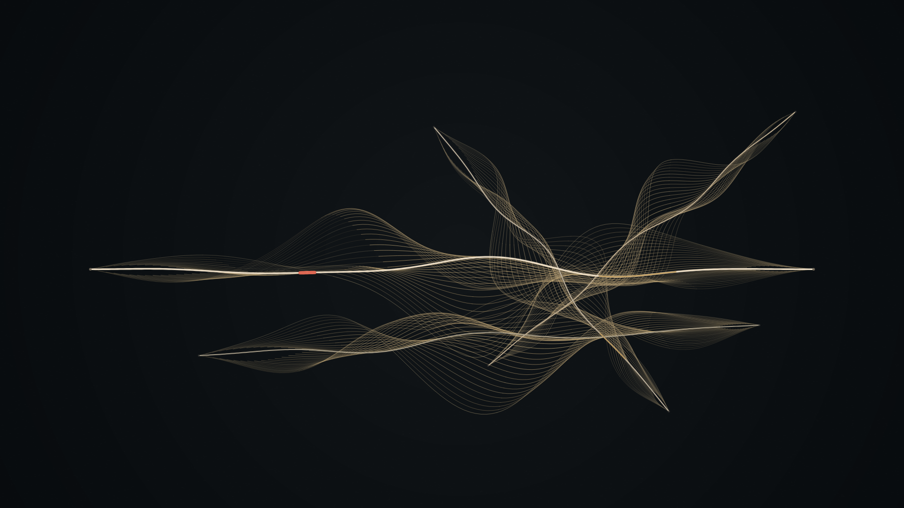

弦的振动与回响织成光，最后留下两道痕迹。

- 用途：叙事短片
- 制作方式：coding-film
- 工具：Canvas + Python + FFmpeg / 合成声音
- 模型：Procedural Canvas and synthesized audio
- [真实产物](https://cloudenshine.github.io/original-ai-gallery/cases/aftertone/index.html) · [源码或提示词](https://cloudenshine.github.io/original-ai-gallery/cases/aftertone/source.zip) · [来源与验证](dist/cases/aftertone/provenance.json)
- 验证：已核对媒体文件 SHA-256；抽象寓言，不是声学或物理仿真。 连续原速观看和真实听审未完成。

## 月汐

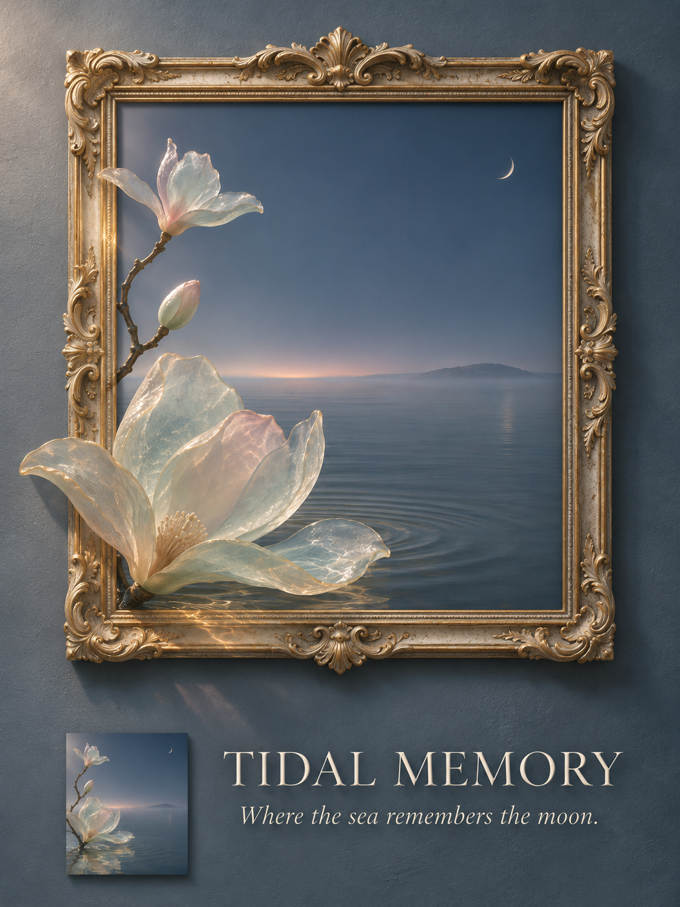

先生成海玻璃玉兰与月海，再把同一场景编辑成出框海报。

- 用途：概念视觉
- 制作方式：image-editing
- 工具：ChatGPT 图像生成与编辑
- 模型：Exact image model not disclosed
- [真实产物](https://cloudenshine.github.io/original-ai-gallery/cases/tidal-memory/index.html) · [源码或提示词](https://cloudenshine.github.io/original-ai-gallery/cases/tidal-memory/source.zip) · [来源与验证](dist/cases/tidal-memory/provenance.json)
- 验证：已核对媒体文件 SHA-256；主要保留主体关系，但不是像素级保真编辑。 现有 1086 × 1448 像素不应称为大幅印刷母版。

## 风的信

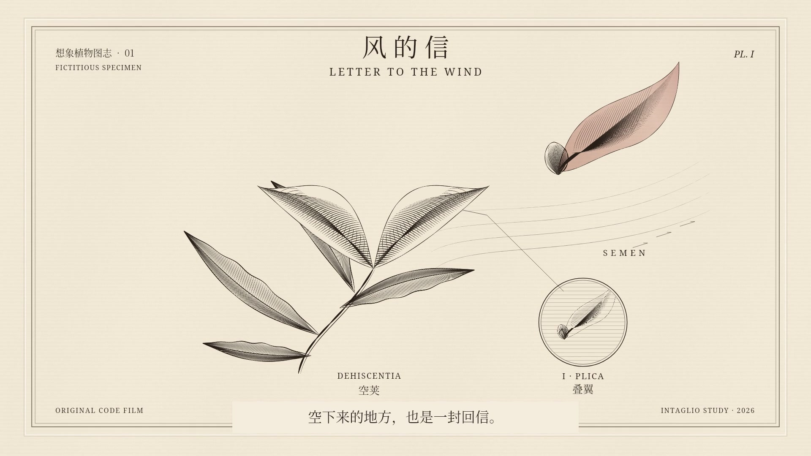

原创虚构种荚张开，翼种离开，以铜版画语言记录。

- 用途：叙事短片
- 制作方式：coding-film
- 工具：Canvas + Python + FFmpeg / 合成声音
- 模型：Procedural Canvas and synthesized audio
- [真实产物](https://cloudenshine.github.io/original-ai-gallery/cases/letter-to-the-wind/index.html) · [源码或提示词](https://cloudenshine.github.io/original-ai-gallery/cases/letter-to-the-wind/source.zip) · [来源与验证](dist/cases/letter-to-the-wind/provenance.json)
- 验证：已核对媒体文件 SHA-256；借鉴铜版画视觉语法，不使用上游原视频、图像或音轨。 虚构植物，不是植物学图解。 原速连续观看和真实听审未完成。

## 把黄昏装进盒子

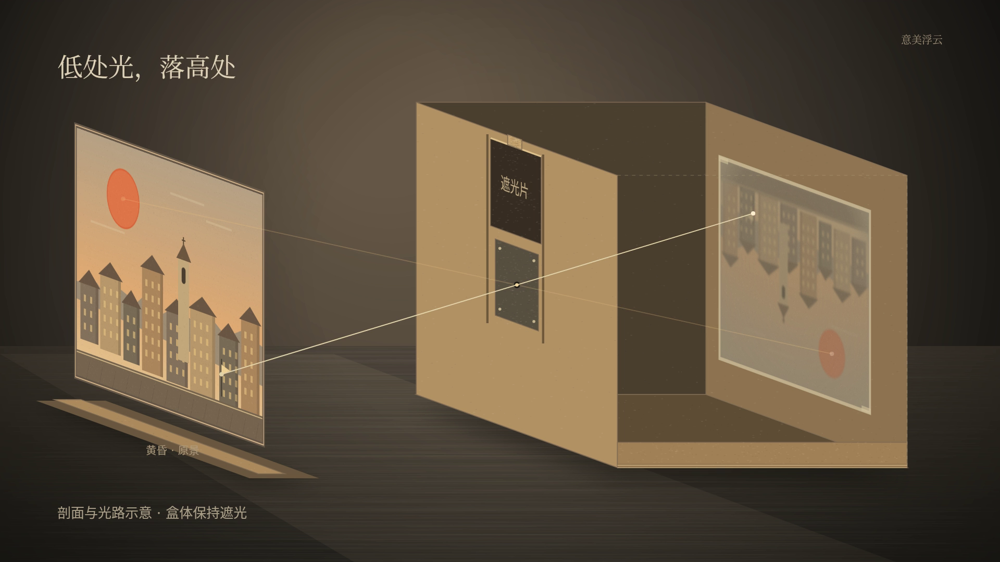

纸盒针孔成像，以同一装置贯穿外观、光路和倒像。

- 用途：叙事短片
- 制作方式：coding-film
- 工具：Canvas + Python + FFmpeg / 合成声音
- 模型：Procedural Canvas and synthesized audio
- [真实产物](https://cloudenshine.github.io/original-ai-gallery/cases/sunset-in-a-box/index.html) · [源码或提示词](https://cloudenshine.github.io/original-ai-gallery/cases/sunset-in-a-box/source.zip) · [来源与验证](dist/cases/sunset-in-a-box/provenance.json)
- 验证：已核对媒体文件 SHA-256；理想化中心投影示意，不是曝光、衍射或测量模拟。 光路渐显只是解释顺序；末段太阳变化为加速示意。 原速连续播放和主观听审未完成。

## 给变化，留一格

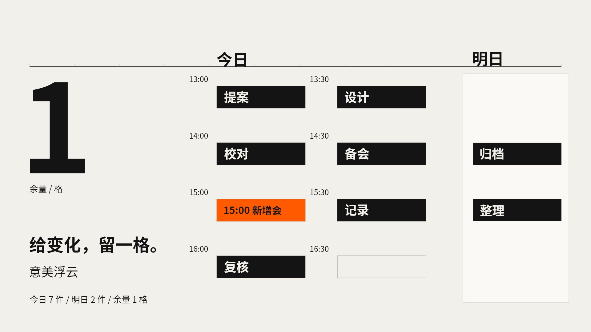

固定 15:00 的新增会遇上排满的日程。两项任务明确改期，空格逐格传递，最终仍留一格余量。

- 用途：瑞士动态排版
- 制作方式：coding-film
- 工具：Canvas + JavaScript + Python 程序合成音频 + FFmpeg
- 模型：Procedural animation and synthesized audio; no generative video or TTS model
- [真实产物](https://cloudenshine.github.io/original-ai-gallery/cases/room-for-change/index.html) · [源码或提示词](https://cloudenshine.github.io/original-ai-gallery/cases/room-for-change/source.zip) · [来源与验证](dist/cases/room-for-change/provenance.json)
- 验证：40 秒、1920 × 1080、24 fps、960 帧、48 kHz 立体声；完整解码及逐帧状态/几何检查通过，最终 AAC 为 −14.93 LUFS / −1.51 dBTP。源码与三份合成分轨恢复检查通过。完整原速连续观看与主观听审未完成，抽帧不等于完整艺术验收。

## 膝关节的一次屈伸

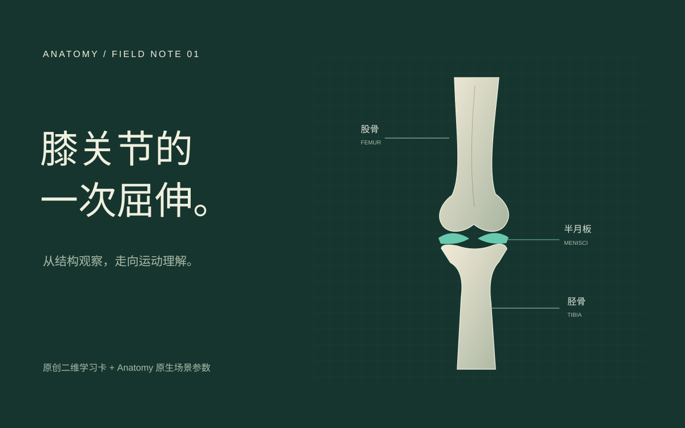

从三块骨、两片半月板到股四头肌，用 Anatomy 编排真实 3D 分步场景，并提供原创二维互动学习卡。

- 用途：解剖教育
- 制作方式：interactive
- 工具：Anatomy + SVG + JavaScript
- 模型：Anatomy 成人参考模型（Z-Anatomy / BodyParts3D）；网页为原创二维示意
- [真实产物](https://cloudenshine.github.io/original-ai-gallery/cases/knee-in-layers/index.html) · [源码或提示词](https://cloudenshine.github.io/original-ai-gallery/cases/knee-in-layers/scene.json) · [来源与验证](dist/cases/knee-in-layers/provenance.json)
- 验证：Anatomy 已接受 4 步场景与 3 项测验；结构名已逐项检索核对。原生查看器显示尚未确认，不声称已目视验证 3D 播放。网页核心 3 项测试通过，云浏览器已验证三主题切换、答题反馈和复制指令；未做移动视口目视验收。 新增54秒有声二维图层导览；非Anatomy 3D模型或屈伸实录。全解码及抽帧通过，浏览器与完整实时看听未验。

## 借力

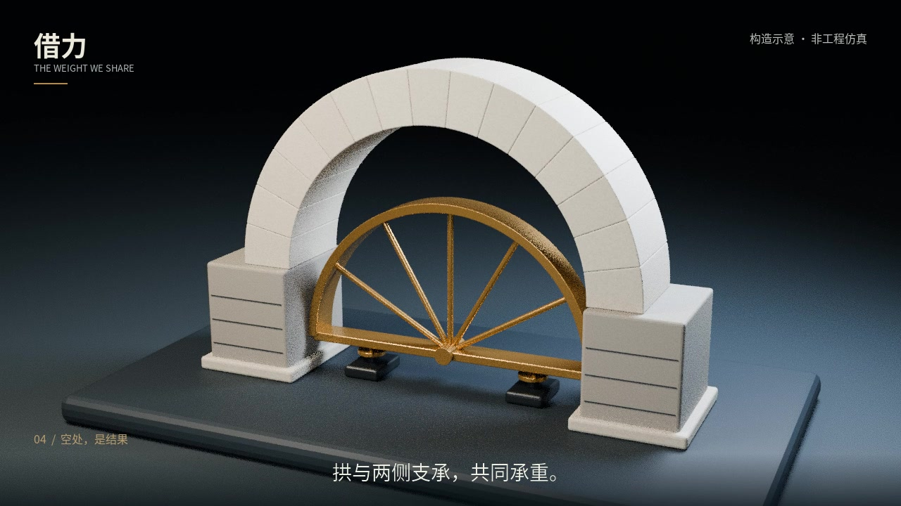

黄铜托架慢慢退下，石拱没有随它下降。沿着真实楔石的厚度与接缝，看见相邻挤压和两端支承怎样共同留下中间的空处。

- 用途：三维构造叙事
- 制作方式：blender-film
- 工具：Blender 4.3.2 · Cycles CPU + Python原创程序音频 + FFmpeg
- 模型：Procedural 3D geometry and keyframe animation; no generative video or structural solver
- [真实产物](https://cloudenshine.github.io/original-ai-gallery/cases/weight-we-share/index.html) · [源码或提示词](https://cloudenshine.github.io/original-ai-gallery/cases/weight-we-share/source.zip) · [来源与验证](dist/cases/weight-we-share/provenance.json)
- 验证：26秒、1280×720、24fps编码（12fps真实运动采样），完整解码通过；624个场景时点及无损分轨往返检查通过。最终AAC约-15.8 LUFS / -5.4 dBTP。完整原速连续观看与主观听审未完成；低采样颗粒与12fps节奏仍需实际观感确认。

## 让安静有形

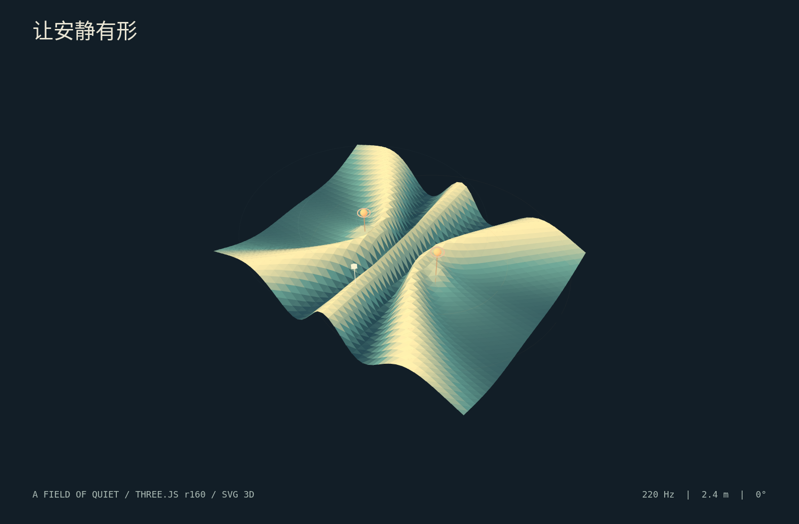

两个声音，不总是更响。改变频率、间距与相位，在真实三维干涉地形上放置探针，让静音区域的形状和关系变得可见。

- 用途：实时三维声学解释
- 制作方式：interactive-3d
- 工具：Three.js r160 + WebGL / SVGRenderer + Web Audio
- 模型：Procedural geometry and synthesized sine tone; no generative image, video, audio or 3D model
- [真实产物](https://cloudenshine.github.io/original-ai-gallery/cases/field-of-quiet/index.html) · [源码或提示词](https://cloudenshine.github.io/original-ai-gallery/cases/field-of-quiet/source.zip) · [来源与验证](dist/cases/field-of-quiet/provenance.json)
- 验证：13项模型与结构测试通过。真实Chrome浏览器已验证 Three.js SVG 3D 备用渲染（1813顶点）、相位/频率/间距、键盘探针、射线拾取、旋转、视角、暂停/复播、声音开关与复位，并导出1600×1050真实渲染封面。当前云浏览器禁用GPU，WebGL主路径未实测；手机实机、Safari/Firefox与主观听审未完成。 30秒、1280×720、10fps离线SVG 3D演示，使用原Three.js场景/相机/1813顶点与官方SVGRenderer；非浏览器或WebGL录屏。17项测试、全文件解码、FLAC及最终AAC的9–15秒静音、源码恢复核对通过；保留原交互。含原创BGM、事件音与示意探针纯音。未做完整实时观看或主观听审。

## 转动之间

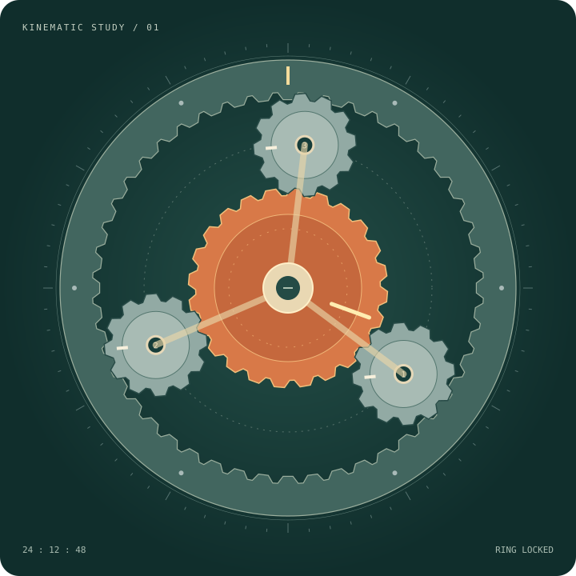

改变的不是齿轮，而是谁留在原地。固定齿圈或行星架，让同一组齿轮在同向减速与反向传动之间切换。

- 用途：机械运动解释
- 制作方式：coding-motion
- 工具：SVG + JavaScript · 理想运动学
- 模型：Procedural vector geometry; no generative image, video or physics solver
- [真实产物](https://cloudenshine.github.io/original-ai-gallery/cases/between-turns/index.html) · [源码或提示词](https://cloudenshine.github.io/original-ai-gallery/cases/between-turns/source.zip) · [来源与验证](dist/cases/between-turns/provenance.json)
- 验证：34秒有声演示已导出（1280×720、24fps、816帧），含原创程序配乐与独立切换提示音；16项运动学、控件和导出时序测试通过，全文件解码与关键帧检查通过。浏览器连续播放、手机实机和完整主观听审未完成。

## 大文件恢复

仓库以 9,000,000 字节分块保存六个大文件。运行 `python3 scripts/restore-binaries.py` 校验每块与完整 SHA-256 并原子恢复；`npm test` 和 `npm run build` 自动执行恢复。无需网络。在线下载链接指向 Pages，是否已部署请检查 GitHub Actions。

[风的信完整母版](https://cloudenshine.github.io/original-ai-gallery/cases/letter-to-the-wind/master.mp4)

## 原创与参考

以下仓库仅提供案例组织与展示思路，未复制其图片、提示词、代码或故事：

- https://github.com/Evolink-AI/awesome-gpt-image-2-6-prompts-and-api
- https://github.com/guanmo-ai/awesome-ai-motion
- https://github.com/lemomo-ai/lemo-opuscar

## 权利

原创源码与媒体均为本次任务新制。AI 生成并非版权或独创性法律保证。公开复用许可尚未选定，不默认授予开源或媒体复用许可。
